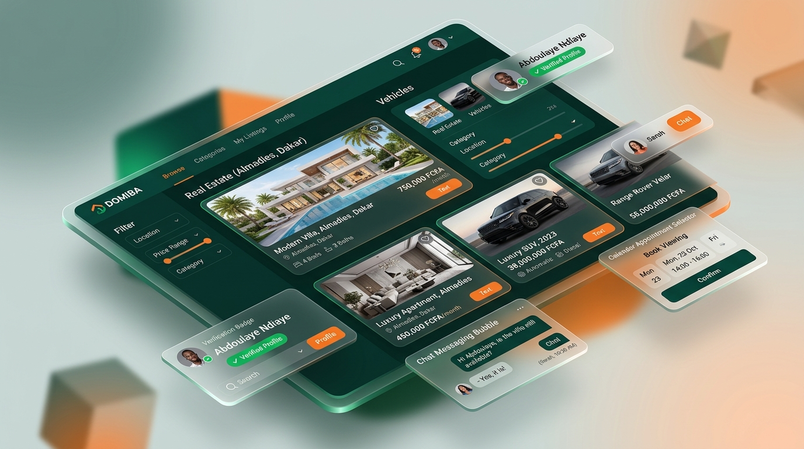
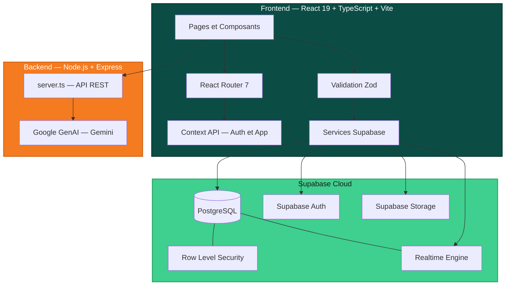
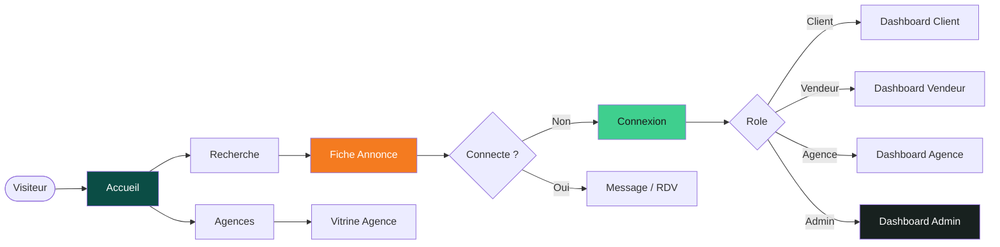
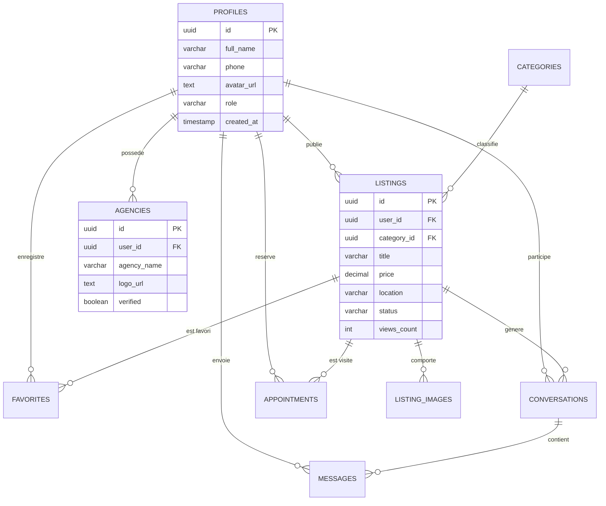
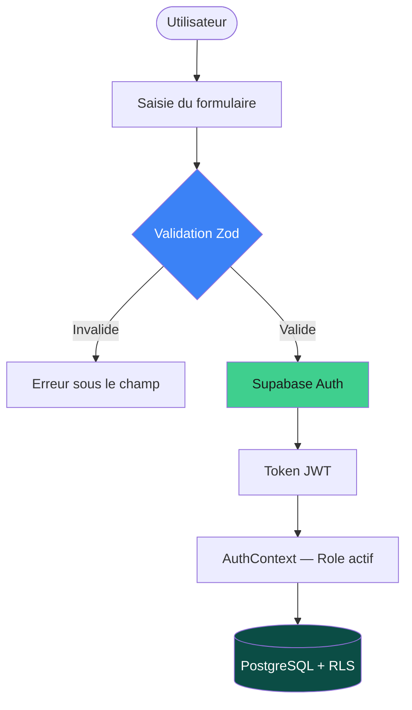

<div align="center">

# 🏠 Kawral
### **Achetez. Louez. Vendez.**

*Plateforme moderne de petites annonces, immobilier et véhicules au Sénégal 🇸🇳*

<br/>


<br/>

[](https://react.dev/)
[](https://www.typescriptlang.org/)
[](https://vitejs.dev/)
[](https://supabase.com/)
[](https://tailwindcss.com/)
[](https://expressjs.com/)
[](https://zod.dev/)
[](https://ai.google.dev/)

<br/>

**🟢 En développement actif** · **v0.2.0** · **Août 2026**

</div>

---

## 📋 Table des matières

- [Aperçu](#-aperçu)
- [Fonctionnalités par rôle](#-fonctionnalités-par-rôle)
- [Architecture](#-architecture)
- [Stack Technologique](#-stack-technologique)
- [Structure du Projet](#-structure-du-projet)
- [Base de données](#-base-de-données)
- [IA et Automatisation](#-ia--automatisation)
- [Système de Design](#-système-de-design)
- [Sécurité et Auth](#-sécurité--authentification)
- [Démarrage Rapide](#-démarrage-rapide)
- [Roadmap](#-roadmap)
- [Contribution](#-contribution)

---

## ✨ Aperçu

**Kawral** *(« Union » en Pulaar)* est une marketplace full-stack sénégalaise nouvelle génération : immobilier haut de gamme, véhicules, petites annonces et agences professionnelles — le tout dans une expérience **Mobile-First**, temps réel, propulsée par l'IA Google Gemini.

### Points clés

| Pilier | Description |
|:---:|:---|
| 🎭 **Multi-rôles** | 4 espaces distincts : Client, Vendeur, Agence, Admin |
| 💬 **Messagerie contextuelle** | Chat temps réel lié à l'annonce avec chips rapides |
| 📅 **Rendez-vous intégrés** | Planification et suivi des visites en direct |
| 🤖 **IA Kawral** | Copilote Gemini pour génération, modération, analyse |
| 🎬 **Listing immersif** | Hero sticky, auto-slide tactile, barre de progression |
| 🛡️ **Sécurité robuste** | Supabase Auth + RLS + validation Zod stricte |

---

## 🌟 Fonctionnalités par rôle

<br/>



<br/>

<table>
<tr>
<td width="50%" valign="top">

### 👤 Client
- Recherche multicritères (prix FCFA, localisation, surface, pièces)
- Favoris avec liste personnalisée ❤️
- Contact direct vendeur ou agence sans quitter la fiche
- Demande de rendez-vous en 1 clic
- Dashboard de suivi (messages, visites, favoris)

</td>
<td width="50%" valign="top">

### 🏪 Vendeur
- Création guidée d'annonces avec upload multi-images
- Dashboard analytique (vues, contacts, conversions)
- Centre de messagerie et gestion des rendez-vous
- Badge de confiance et indicateur de présence
- Score vendeur public visible sur la fiche

</td>
</tr>
<tr>
<td width="50%" valign="top">

### 🏢 Agence
- Profil certifié (bannière, logo, biographie officielle)
- Vitrine publique dédiée `/agencies/:id`
- Portefeuille multi-biens géré par lots
- Page publique en lecture seule *(équipe à venir)*

</td>
<td width="50%" valign="top">

### 🛡️ Admin
- Cockpit global : métriques, annonces, inscrits
- Assistant IA administratif Kawral (Gemini)
- Modération de contenu et validation des annonces
- Gestion des rôles et certification des agences

</td>
</tr>
</table>

---

## 🏗️ Architecture

### Schéma global du système



### Flux de navigation utilisateur



---

## 💻 Stack Technologique

<table>
<tr>
<td align="center" width="33%">

### 🎨 Frontend
| Outil | Version |
|:---|:---:|
| React | `19.0.1` |
| TypeScript | `5.8` |
| Vite | `6.2` |
| Tailwind CSS | `4.1` |
| Lucide React | `0.546` |
| React Router | `7.18` |
| Zod | `3.23.8` |

</td>
<td align="center" width="33%">

### ⚙️ Backend et IA
| Outil | Version |
|:---|:---:|
| Express.js | `4.21` |
| Node.js | `18+` |
| TSX | `4.21` |
| @google/genai | `2.17` |
| Dotenv | `17.2` |
| ESBuild | `0.25` |

</td>
<td align="center" width="33%">

### 🗄️ Données et Cloud
| Outil | Type |
|:---|:---:|
| Supabase | BaaS Cloud |
| PostgreSQL | SQL |
| Supabase Auth | JWT |
| Supabase Storage | CDN |
| RLS Policies | Sécurité |
| Realtime | WebSocket |

</td>
</tr>
</table>

---

## 📁 Structure du Projet

```
kawral/
│
├── index.html                       # Template SPA
├── server.ts                        # API Express + proxy Gemini
├── package.json
├── vite.config.ts
├── tsconfig.json
│
├── src/
│   ├── main.tsx                     # Entrée React + BrowserRouter
│   ├── App.tsx                      # Shell global (Navbar, Footer, Modals)
│   ├── index.css                    # Tokens Tailwind kawral-* + animations
│   │
│   ├── routes/
│   │   └── index.tsx                # Routes centralisées + ProtectedRoute
│   │
│   ├── features/                    # Modules par domaine métier
│   │   ├── marketplace/pages/       # HomePage, SearchPage, ListingDetailPage, AgenciesPage
│   │   ├── seller/pages/            # SellerDashboard, CreateListingPage
│   │   ├── agency/pages/            # AgencyDashboard, AgencyDetailPage
│   │   ├── client/pages/            # ClientDashboard, Favoris, Messagerie, RDV
│   │   ├── admin/pages/             # AdminDashboard + IA Kawral
│   │   └── shared/pages/            # NotFoundPage, ResetPasswordPage
│   │
│   ├── components/
│   │   ├── auth/                    # AuthModal avec validation Zod par champ
│   │   ├── layout/                  # Navbar, MobileNavigation, Footer
│   │   ├── marketplace/             # ListingCard, AgencyCard, FilterSidebar
│   │   ├── modals/                  # AppointmentModal, ProfileSettingsModal
│   │   └── ui/                      # PasswordInput, Avatar, Toast, Badges
│   │
│   ├── context/
│   │   ├── AppContext.tsx           # Filtres, toasts, annonces, navigation
│   │   └── AuthContext.tsx          # Session Supabase, roles, profil actif
│   │
│   ├── services/supabase/
│   │   ├── listingsService.ts       # CRUD Annonces
│   │   ├── profileService.ts        # Profils et roles
│   │   ├── messagesService.ts       # Conversations et messages
│   │   ├── appointmentsService.ts   # Rendez-vous
│   │   ├── agenciesService.ts       # Agences
│   │   └── storageService.ts        # Upload images et avatars
│   │
│   ├── lib/
│   │   ├── supabase.ts              # Client Supabase configuré
│   │   └── validation.ts            # Schemas Zod centralisés
│   │
│   ├── types/index.ts               # Types TypeScript globaux
│   └── utils/                       # formatters FCFA, dates, UUID
│
├── scripts/
│   ├── generate-seed.ts             # Données de test réalistes
│   └── sync-supabase.ts             # Synchronisation schema SQL
│
└── public/images/                   # Illustrations officielles
```

### Table des routes

| Route | Composant | Accès |
|:---|:---|:---:|
| `/` | `HomePage` | Public |
| `/explorer` | `SearchPage` | Public |
| `/listings/:id` | `ListingDetailPage` | Public |
| `/agencies` | `AgenciesPage` | Public |
| `/agencies/:id` | `AgencyDetailPage` | Public |
| `/auth/reset-password` | `ResetPasswordPage` | Public |
| `/dashboard/client/*` | `ClientDashboard` | 🔒 |
| `/dashboard/seller/*` | `SellerDashboard` | 🔒 |
| `/dashboard/agency/*` | `AgencyDashboard` | 🔒 |
| `/admin/*` | `AdminDashboard` | 🔒 Admin |

---

## 🗄️ Base de Données

### Schéma Entité-Association



### Intégrité Référentielle

| Table | Clé Étrangère | Parent | ON DELETE |
|:---|:---|:---|:---:|
| `agencies` | `user_id` | `profiles` | **CASCADE** |
| `listings` | `user_id` | `profiles` | **CASCADE** |
| `listing_images` | `listing_id` | `listings` | **CASCADE** |
| `favorites` | `user_id`, `listing_id` | `profiles`, `listings` | **CASCADE** |
| `conversations` | `buyer_id`, `seller_id` | `profiles` | **CASCADE** |
| `conversations` | `listing_id` | `listings` | **SET NULL** |
| `messages` | `conversation_id` | `conversations` | **CASCADE** |
| `appointments` | `client_id` | `profiles` | **CASCADE** |
| `appointments` | `listing_id` | `listings` | **SET NULL** |

> Supprimer un profil supprime en cascade toutes ses données (annonces, messages, agence…)

---

## 🤖 IA & Automatisation

<br/>


<br/>

Kawral intègre l'API **Google GenAI (Gemini)** via un serveur Express proxy :

| Capacité | Description |
|:---|:---|
| ✍️ **Génération d'annonces** | Transformation de caractéristiques en descriptions professionnelles |
| 🛡️ **Modération automatisée** | Analyse sémantique pour bloquer fraudes et contenus abusifs |
| ⚡ **Assistant Admin** | Commandes en langage naturel pour auditer et automatiser des tâches |
| 💬 **Assistant Utilisateur** | Aide contextuelle à la recherche pour tous les utilisateurs connectés |

---

## 🎨 Système de Design

L'identité visuelle de Kawral célèbre l'élégance africaine contemporaine :

| Token | Nom | Hex | Usage |
|:---|:---|:---:|:---|
| `kawral-green` | Émeraude Foncé | `#0B4D45` | Boutons primaires, headers, branding |
| `kawral-orange` | Ambre Vif | `#F47B20` | CTA, accents, badges promotionnels |
| `kawral-ivory` | Ivoire Épuré | `#FAF7F0` | Arrière-plans, surfaces calmes |
| `kawral-dark` | Noir Profond | `#18211F` | Typographie principale |
| `kawral-muted` | Gris Minéral | `#66726D` | Textes secondaires, métadonnées |
| `kawral-border` | Bordure Douce | `#E5E0D8` | Cartes, séparateurs |

### Principes de design
- 📱 **Mobile-First** — Navigation bas d'écran native sur mobile
- 🔘 **Composants arrondis** — `rounded-2xl` / `rounded-3xl`
- ✨ **Micro-animations** — Transitions fluides avec Framer Motion / CSS
- 🖼️ **Cards modernes** — Ombres douces, bordures subtiles, galerie immersive

---

## 🔐 Sécurité & Authentification

### Pipeline de sécurité



| Fonctionnalité | Détail |
|:---|:---|
| 🔑 **Auth** | Email + mot de passe via Supabase Auth |
| 🔒 **Sessions** | JWT avec refresh automatique |
| 🛡️ **RLS** | Politiques Row Level Security par table |
| 👥 **RBAC** | Dashboards et actions filtrés par rôle |
| ✅ **Validation Zod** | Email, password min 8 chars + chiffre, téléphone sénégalais |
| 🔄 **Reset password** | Lien email Supabase vers `ResetPasswordPage` sécurisée |

---

## 🚀 Démarrage Rapide

### Prérequis
- **Node.js** v18+ ou **Bun**
- Compte et projet **Supabase**
- Clé **Google GenAI** ou **OpenRouter** *(optionnel pour l'IA)*

### Installation

```bash
# 1 — Cloner et installer
git clone https://github.com/Ibrahima96/kawral.git
cd kawral
npm install

# 2 — Configuration
cp .env.example .env
```

### Variables d'environnement

```env
VITE_SUPABASE_URL=https://votre-projet.supabase.co
VITE_SUPABASE_ANON_KEY=votre_cle_anon
GEMINI_API_KEY=votre_cle_gemini
OPENROUTER_API_KEY=votre_cle_openrouter
OPENROUTER_VISION_MODEL=google/gemini-2.0-flash-exp:free
APP_URL=http://localhost:3000
```

OpenRouter est utilisé en priorité pour analyser les images lors de la génération de descriptions et du remplissage automatique. Gemini Vision est utilisé automatiquement en secours.

### Base de données

```bash
npx tsx scripts/sync-supabase.ts   # Applique le schema SQL
npx tsx scripts/generate-seed.ts   # Insere des donnees de test
```

### Lancer le projet

```bash
npm run dev   # Disponible sur http://localhost:3000
```

### Scripts disponibles

| Commande | Description |
|:---|:---|
| `npm run dev` | Serveur de développement Hot-Reload |
| `npm run build` | Build de production |
| `npm run preview` | Prévisualisation du build |
| `npm run lint` | Vérification TypeScript |

---

## 📍 Roadmap

- [x] Authentification Supabase complète (email, reset, callback OAuth)
- [x] Dashboards dédiés pour les 4 rôles
- [x] Marketplace avec recherche, filtres avancés et tri
- [x] Messagerie temps réel et gestion des rendez-vous
- [x] Fiche annonce immersive (auto-slide, swipe tactile, hero sticky)
- [x] Vitrine publique d'agence `/agencies/:id`
- [x] Validation Zod sur tous les formulaires
- [x] Assistant IA Kawral (Google Gemini via Express)
- [x] Navigation Mobile-First (bottom navigation filtrée par rôle)
- [ ] Notifications Push temps réel
- [ ] Système de notes et avis vérifiés après visite
- [ ] Paiements intégrés (Wave / Orange Money)
- [ ] Application mobile native (React Native)
- [ ] Déploiement production (Vercel + Railway)

---

## 🤝 Contribution

1. Créez une branche : `git checkout -b feature/ma-super-feature`
2. Committez : `git commit -m 'feat: description claire'`
3. Poussez : `git push origin feature/ma-super-feature`
4. Ouvrez une **Pull Request** sur `develop`

---

<div align="center">

**Fait avec ❤️ pour le Sénégal 🇸🇳**

*Kawral — Achetez. Louez. Vendez.*

</div>
