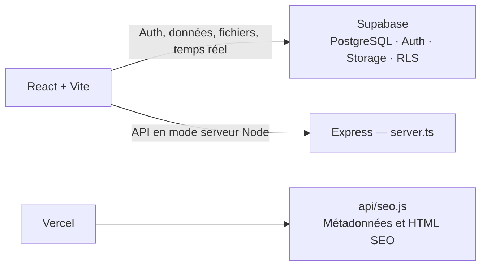

<div align="center">

# 🏠 Kawral
### **Achetez. Louez. Vendez.**

*Achetez, vendez et louez au Sénégal : immobilier, véhicules, mode, maison, électronique, loisirs et plus encore 🇸🇳*


[](https://react.dev/)
[](https://www.typescriptlang.org/)
[](https://vite.dev/)
[](https://supabase.com/)
[](https://tailwindcss.com/)

</div>

---

## Aperçu

Kawral est une plateforme mobile-first de vente et de location au Sénégal, couvrant de nombreuses catégories : immobilier, véhicules, matériel professionnel, mode, maison et jardin, électronique, loisirs et bien d'autres. Les visiteurs peuvent parcourir et filtrer les offres, tandis que les membres peuvent enregistrer des favoris, échanger avec les vendeurs et demander des rendez-vous. Les vendeurs disposent d'un espace pour publier et gérer leurs offres.

### Fonctionnalités

- Recherche et filtres par catégorie, prix et localisation
- Fiches d'annonces avec galerie d'images et détails adaptés à la catégorie
- Comptes client, vendeur et administrateur
- Publication et gestion d'annonces par étapes
- Favoris, messagerie liée aux annonces et rendez-vous
- Tableau de bord d'administration et outils de modération
- Pages légales, métadonnées SEO, sitemap et expérience PWA

> Les anciennes routes d'agence restent prises en charge par redirection. Le rôle agence n'est plus proposé comme rôle distinct dans le flux actuel.

## Stack et architecture

| Partie | Technologies |
|:---|:---|
| Interface | React 19, TypeScript 5.8, Vite 6, Tailwind CSS 4, React Router 7 |
| Composants | Radix UI, Lucide React, Motion, Sonner |
| Validation | Zod |
| Données et authentification | Supabase Auth, PostgreSQL, Storage, Realtime et RLS |
| Serveur Node | Express 4, TSX |
| SEO sur Vercel | Fonction `api/seo.js`, rendu de métadonnées pour les annonces et catégories |

Le navigateur utilise les services Supabase pour les fonctionnalités marketplace. `server.ts` lance Express et Vite en développement et expose aussi des endpoints de santé, de validation d'adresse email et d'analytics. Le déploiement Vercel configure séparément le routage SEO dans `api/seo.js`.



## Rôles et parcours

| Rôle | Fonctions principales |
|:---|:---|
| **Visiteur** | Accueil, recherche, catégories et fiches d'annonces |
| **Client** | Favoris, messagerie, demandes de rendez-vous et espace personnel |
| **Vendeur** | Création et gestion des annonces, messagerie et rendez-vous |
| **Admin** | Tableau de bord, gestion des annonces et modération |

Les rôles applicatifs sont `client`, `seller` et `admin`. La base de données utilise notamment `vendeur` pour les profils vendeurs. Les anciennes URL `/agencies`, `/auth/register/agency` et `/dashboard/agency` redirigent vers les parcours actuels.

## Routes principales

| Route | Accès | Description |
|:---|:---:|:---|
| `/` | Public | Accueil |
| `/explorer` | Public | Recherche et filtres |
| `/explorer/:slug` | Public | Recherche par catégorie |
| `/listings/:id` | Public | Détail d'une annonce |
| `/annonces/:id`, `/annonce/:id` | Public | Alias historiques des fiches |
| `/auth/login`, `/auth/register` | Public | Connexion et inscription |
| `/auth/reset-password` | Public | Réinitialisation du mot de passe |
| `/dashboard/client/*` | Connecté | Espace client |
| `/dashboard/seller/*` | Vendeur | Espace vendeur |
| `/admin/*` | Admin | Administration |

## Structure du dépôt

```text
src/
├── components/                 # Interface partagée, navigation, modales et UI
├── context/                    # États applicatifs et authentification
├── data/                       # Catégories, caractéristiques et données locales
├── features/
│   ├── marketplace/            # Accueil, recherche et détails d'annonce
│   ├── client/                 # Favoris et espace client
│   ├── seller/                 # Tableau de bord et création d'annonce
│   ├── admin/                  # Administration et modération
│   └── shared/                 # Messagerie, rendez-vous et pages communes
├── lib/                        # Supabase, validation et analytics
├── services/supabase/          # Accès aux annonces, profils, messages, etc.
├── routes/index.tsx            # Définition des routes et protections
└── types/                      # Types partagés

api/seo.js                      # Handler SEO pour Vercel
server.ts                       # Serveur Express et Vite
scripts/generate-sitemap.ts     # Génération du sitemap
supabase/schema.sql             # Schéma de référence
supabase/migrations/            # Migrations SQL ordonnées
tests/                          # Tests SEO et scénarios k6
```

## Données et sécurité

Le schéma Supabase couvre les profils, catégories, annonces, images, favoris, conversations, messages, rendez-vous et disponibilités. Les scripts SQL de `supabase/migrations/` font évoluer le schéma au fil du projet.

L'authentification est gérée par Supabase Auth. Les politiques Row Level Security définissent l'accès aux données et les routes privées de l'interface sont protégées par rôle. Appliquez le schéma et les migrations à votre projet Supabase avant d'utiliser les fonctionnalités connectées. `supabase/schema.sql` est la référence du schéma ; les migrations documentent les changements incrémentaux.

## Configuration locale

### Prérequis

- Node.js 18 ou plus récent
- npm
- Un projet Supabase pour l'authentification et les données

### Installation

```bash
git clone https://github.com/Ibrahima96/kawral.git
cd kawral
npm install
```

Créez un fichier `.env` à la racine (vous pouvez partir de `.env.example`) et définissez au minimum :

```env
VITE_SUPABASE_URL=https://votre-projet.supabase.co
VITE_SUPABASE_ANON_KEY=votre_cle_publique_supabase
```

La clé Supabase utilisée côté navigateur doit être la clé publique anon/publishable. Ne placez jamais une clé `service_role` ou un secret privé dans une variable `VITE_*`.

Google Analytics est facultatif. Les variables `VITE_GA_MEASUREMENT_ID`, `GA_STREAM_ID`, `GA_STREAM_NAME` et `GA_STREAM_URL` configurent la mesure et les informations du flux. `GA_API_SECRET`, `GA_PROPERTY_ID`, `GA_CLIENT_EMAIL` et `GA_PRIVATE_KEY` servent aux fonctions serveur Analytics correspondantes. Consultez `.env.example` pour la liste des noms reconnus.

### Lancer en développement

```bash
npm run dev
```

L'application est servie par défaut sur [http://localhost:3000](http://localhost:3000).

### Commandes disponibles

| Commande | Description |
|:---|:---|
| `npm run dev` | Lance le serveur Express et Vite en mode développement |
| `npm run build` | Génère le sitemap puis compile l'application Vite |
| `npm start` | Lance `dist/server.cjs` (ce fichier doit être fourni par le processus de déploiement) |
| `npm run preview` | Prévisualise le build Vite |
| `npm run lint` | Vérifie les types TypeScript (`tsc --noEmit`) |
| `npm run test:seo` | Lance les tests SEO |
| `npm run test:k6:smoke` | Lance le scénario k6 de fumée (k6 requis) |
| `npm run test:k6:load` | Lance le scénario k6 de charge (k6 requis) |
| `npm run test:k6:stress` | Lance le scénario k6 de stress (k6 requis) |
| `npm run test:k6:spike` | Lance le scénario k6 de pic de trafic (k6 requis) |

## Développement

Les migrations et le schéma se trouvent dans `supabase/`. Examinez les scripts SQL et la cible Supabase avant de les appliquer. Le script `scripts/sync-supabase.ts` génère des données SQL depuis des données locales de démonstration ; il ne remplace pas l'application du schéma et des migrations.

Le script `npm run build` génère le build frontend Vite, mais ne compile pas `server.ts` en `dist/server.cjs`. La commande `npm start` suppose donc que cet artefact serveur est préparé séparément.

Pour contribuer, créez une branche dédiée, décrivez le changement dans un commit clair et ouvrez une pull request avec les étapes de vérification pertinentes.

---

<div align="center">

**Fait avec ❤️ pour le Sénégal 🇸🇳**

*Kawral — Achetez. Louez. Vendez.*

</div>
