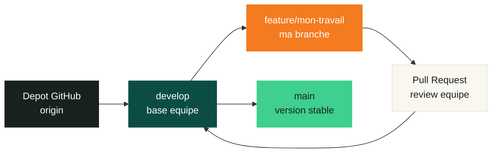
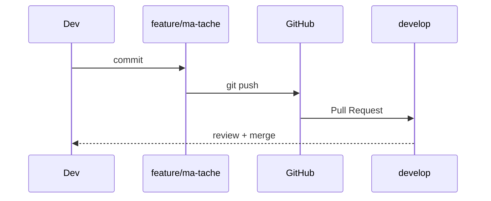
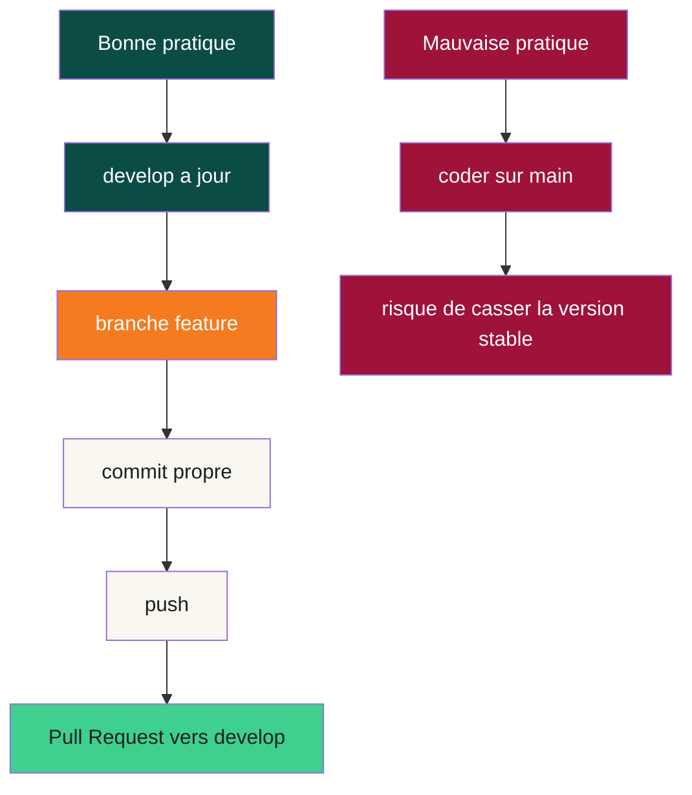

# Guide Git de l'equipe Kawral

> Objectif : permettre a chaque membre de l'equipe de recuperer le projet, travailler proprement depuis `develop`, recuperer les modifications des autres, puis pousser son travail sans casser le depot.

<div align="center">


**Regle d'or : on ne travaille pas directement sur `main`. On part de `develop`, puis chacun code dans sa branche feature.**

</div>

---

## Vue D'ensemble



| Branche | Role | Qui l'utilise ? |
|---|---|---|
| `main` | Version stable / propre | Lead ou responsable merge |
| `develop` | Base commune de l'equipe | Tout le monde recupere depuis ici |
| `feature/...` | Travail individuel | Chaque dev cree sa propre branche |

---

## 1. Recuperer Le Projet Pour La Premiere Fois

### Option recommandee : cloner directement `develop`

```bash
git clone -b develop https://github.com/Ibrahima96/kawral.git
cd kawral
npm install
npm run dev
```

### Verifier que tu es bien sur `develop`

```bash
git branch
```

Tu dois voir :

```bash
* develop
```

Si tu n'es pas sur `develop` :

```bash
git checkout develop
```

---

## 2. Demarrer Une Nouvelle Tache

Avant de coder, pars toujours d'un `develop` a jour.

```bash
git checkout develop
git pull origin develop
```

Ensuite cree ta branche :

```bash
git checkout -b feature/mon-nom-ma-tache
```

Exemples :

```bash
git checkout -b feature/ciss-messaging
git checkout -b feature/diallo-create-listing
git checkout -b feature/sagna-ui-review
```

<div align="center">

```text
develop a jour
     |
     +-- feature/ciss-messaging
     |
     +-- feature/diallo-create-listing
     |
     +-- feature/sagna-ui-review
```

</div>

---

## 3. Recuperer Les Modifications De L'equipe

Quand quelqu'un a pousse du nouveau code sur `develop`, recupere-le comme ceci.

### Si tu es sur `develop`

```bash
git checkout develop
git pull origin develop
```

### Si tu es deja sur ta branche feature

```bash
git checkout feature/mon-nom-ma-tache
git fetch origin
git merge origin/develop
```

Apres le merge, teste le projet :

```bash
npm run lint
npm run build
```

Si tout passe, continue a travailler.

---

## 4. Envoyer Ton Travail

### Voir ce que tu as modifie

```bash
git status
```

### Ajouter les fichiers

```bash
git add .
```

### Creer un commit clair

```bash
git commit -m "feat: ajouter la messagerie client"
```

Formats recommandes :

| Prefixe | Quand l'utiliser ? | Exemple |
|---|---|---|
| `feat:` | Nouvelle fonctionnalite | `feat: ajouter creation annonce` |
| `fix:` | Correction de bug | `fix: corriger filtre prix` |
| `docs:` | Documentation | `docs: ajouter guide git equipe` |
| `refactor:` | Nettoyage sans changer le comportement | `refactor: simplifier service annonces` |
| `style:` | CSS, mise en page, UI | `style: ajuster navbar mobile` |

### Pousser ta branche sur GitHub

```bash
git push origin feature/mon-nom-ma-tache
```

Ensuite, ouvre une Pull Request vers `develop`.



---

## 5. Routine Quotidienne

Copie-colle cette routine chaque matin avant de coder.

```bash
git checkout develop
git pull origin develop
git checkout feature/mon-nom-ma-tache
git merge origin/develop
npm run lint
```

Puis tu peux coder tranquillement.

```text
Matin
  |
  +-- Je mets develop a jour
  |
  +-- Je ramene develop dans ma branche
  |
  +-- Je lance les checks
  |
  +-- Je code
```

---

## 6. Quand Git Dit "Conflit"

Un conflit veut dire que deux personnes ont modifie la meme zone d'un fichier.

Git affiche souvent ceci :

```text
ton code
```

Que faire :

1. Ouvre le fichier en conflit.
2. Garde la bonne version du code, ou combine les deux.
3. Supprime les lignes `<<<<<<<`, `=======`, `>>>>>>>`.
4. Lance les checks.
5. Termine le merge.

```bash
npm run lint
git add .
git commit
```

Si tu n'es pas sur, demande a la personne qui a modifie le meme fichier.

---

## 7. Commandes SOS

| Situation | Commande |
|---|---|
| Voir ta branche actuelle | `git branch --show-current` |
| Voir les fichiers modifies | `git status` |
| Voir l'historique recent | `git log --oneline --graph --decorate -10` |
| Recuperer les branches distantes | `git fetch origin` |
| Changer de branche | `git checkout nom-de-branche` |
| Creer une branche | `git checkout -b feature/nom-tache` |
| Annuler un fichier non commit | `git restore chemin/du/fichier` |
| Mettre de cote ton travail | `git stash` |
| Recuperer ton travail mis de cote | `git stash pop` |

---

## 8. Ce Qu'il Ne Faut Pas Faire

```text
NE PAS coder directement sur main
NE PAS pousser sur develop sans validation equipe
NE PAS faire git push --force sur une branche partagee
NE PAS supprimer une branche si la PR n'est pas mergee
NE PAS commit le fichier .env
```

La branche `develop` est la route principale de l'equipe. Les branches `feature/...` sont les voies de travail individuelles.



---

## 9. Installation Et Lancement Du Projet

Apres avoir clone le projet :

```bash
npm install
npm run dev
```

Commandes utiles du projet :

| Commande | Role |
|---|---|
| `npm run dev` | Lance le projet en local |
| `npm run lint` | Verifie TypeScript |
| `npm run build` | Verifie que le projet build correctement |
| `npm start` | Lance la version build |

---

## 10. Checklist Avant De Demander Une Review

Avant d'ouvrir une Pull Request vers `develop`, verifie :

- [ ] Je suis sur une branche `feature/...`
- [ ] J'ai recupere les dernieres modifications de `develop`
- [ ] `npm run lint` passe
- [ ] `npm run build` passe
- [ ] Mon commit a un message clair
- [ ] Je n'ai pas ajoute `.env`
- [ ] Ma Pull Request cible bien `develop`

---

<div align="center">

## Workflow Final A Retenir

```text
CLONE develop
   -> CREER feature/ma-tache
      -> CODER
         -> COMMIT
            -> PULL/MERGE develop
               -> TESTER
                  -> PUSH
                     -> PR vers develop
```

**Kawral avance proprement quand chacun garde sa branche a jour.**

</div>
