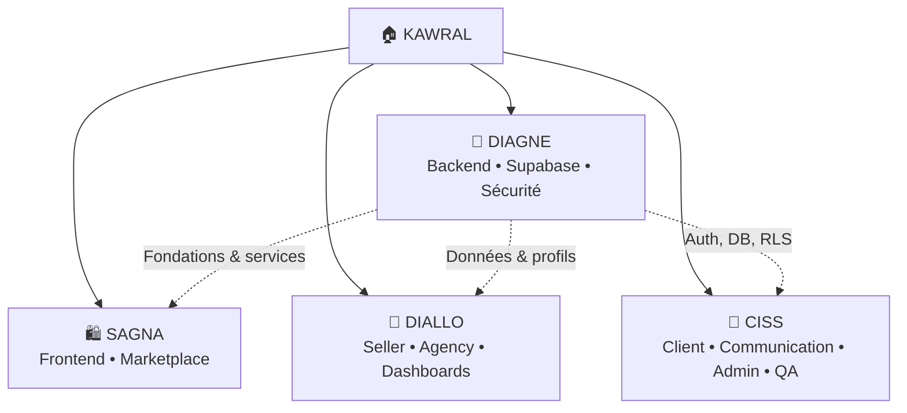
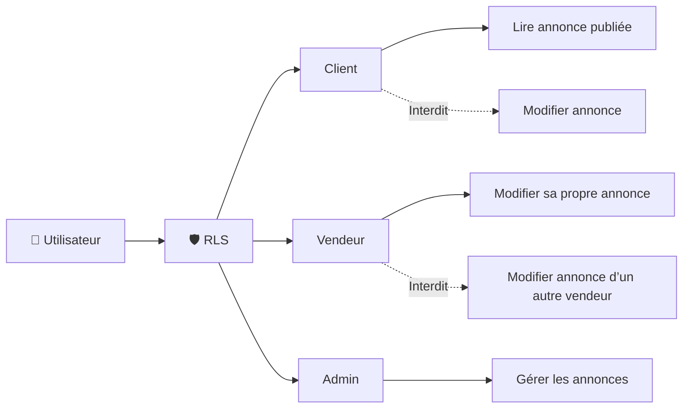
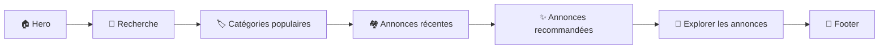
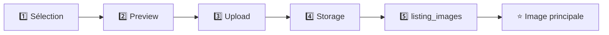
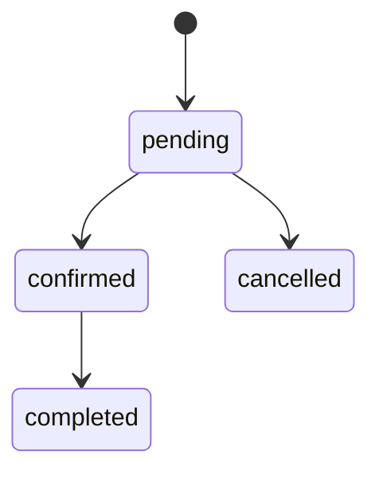
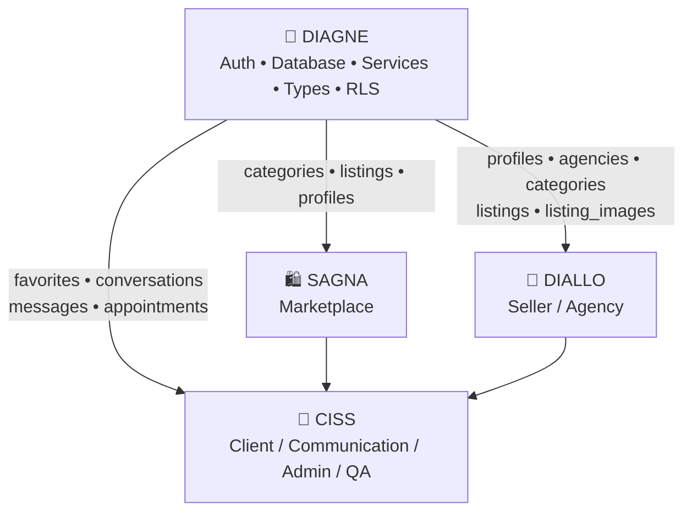
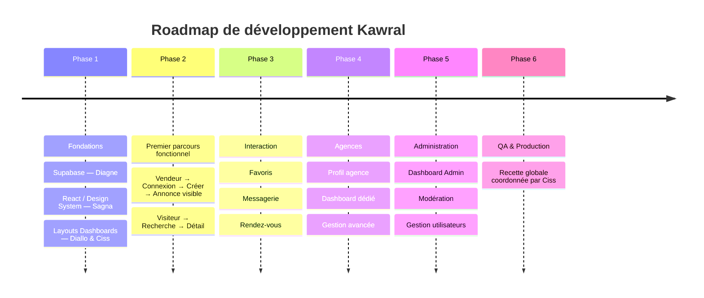
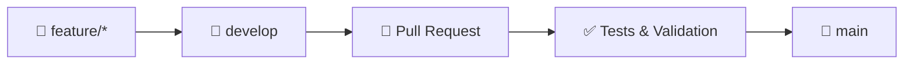

# 🏠 KAWRAL
## Répartition détaillée du développement par pôle et membre d’équipe

> **Document de spécifications • Organisation technique • Roadmap • Definition of Done**

---

## 🌐 1. Vue globale de l’équipe

Kawral est organisé autour de **4 pôles complémentaires** : backend & sécurité, marketplace, espaces vendeur/agence, puis client/communication/admin/QA.



| Membre | Pôle | Responsabilité principale |
|---|---|---|
| **Diagne** | Backend / Supabase / Sécurité | Base de données, Auth, RLS, Storage, services backend |
| **Sagna** | Frontend / Marketplace | Accueil, recherche, catégories, annonces, détail |
| **Diallo** | Seller / Agency | Publication et gestion des annonces + dashboards |
| **Ciss** | Client / Communication / Admin / QA | Favoris, messagerie, RDV, espace client, admin, tests |

---

# 🔐 2. DIAGNE — Backend, Supabase & Sécurité

> **« Je construis le moteur de Kawral. »**

### 🎯 Mission

Diagne est responsable de tout le **socle backend**. Il ne développe pas les interfaces métier principales : il fournit les fondations permettant aux trois autres membres de travailler.

### 2.1 Initialisation Supabase

**Tâches**

- Créer/configurer le projet Supabase
- Configurer PostgreSQL, Auth et Storage
- Préparer les environnements
- Définir les variables d’environnement
- Documenter la connexion au projet

**Livrables**

```text
supabase/
├── migrations/
├── seed/
└── README.md
```

### 2.2 Base de données

Diagne implémente le modèle défini précédemment.

**Tables**

`profiles` · `agencies` · `categories` · `listings` · `listing_images` · `favorites` · `conversations` · `messages` · `appointments`

**Gestion**

- Primary Keys (PK)
- Foreign Keys (FK)
- Contraintes
- Enums
- Indexes
- Timestamps
- Triggers
- Relations

### 2.3 Authentification

**Fonctionnalités**

- Inscription
- Connexion
- Déconnexion
- Mot de passe oublié
- Session utilisateur
- Profil
- Rôle

**Rôles**

`client` · `seller` · `agency` · `admin`

**Fonctions exportées**

```js
signUp()
signIn()
signOut()
getCurrentUser()
getCurrentProfile()
```

### 2.4 RLS — Row Level Security

> ⚠️ **Responsabilité majeure de Diagne**

Les règles RLS doivent garantir que chaque utilisateur ne puisse accéder qu'aux données autorisées.



### 2.5 Storage

**Buckets configurés**

- `listing-images`
- `avatars`
- `agency-assets`

**Policies**

- Le vendeur peut uploader une image de **sa propre annonce**.
- Le vendeur ne doit pas pouvoir supprimer une image appartenant à une autre annonce.

### 2.6 Services Supabase

```text
services/
└── supabase/
    ├── auth.service.js
    ├── listings.service.js
    ├── categories.service.js
    ├── profiles.service.js
    ├── favorites.service.js
    ├── messages.service.js
    └── appointments.service.js
```

### ✅ Checklist Diagne

- [x] Database
- [x] Auth
- [x] Roles
- [x] RLS
- [x] Storage
- [x] Supabase services
- [x] Seed categories
- [x] Documentation backend

---

# 🛍️ 3. SAGNA — Frontend Marketplace

> **« Je construis la marketplace que les utilisateurs voient. »**

### 🎯 Mission

Sagna développe toute l’**expérience publique de Kawral**, c’est-à-dire l’interface principalement visible par les visiteurs.

### 3.1 Design System

**Composants communs**

`Button` · `Input` · `Select` · `Modal` · `Card` · `Badge` · `Avatar` · `Dropdown` · `Pagination` · `Spinner` · `Toast`

**À définir**

- Couleurs
- Typographie
- Espacements
- Bordures
- Ombres
- Responsive design

### 3.2 Navbar

**Avant connexion**

```text
KAWRAL | Accueil | Explorer | Catégories | [Rechercher...] | Publier une annonce | Connexion
```

**Après connexion**

```text
Profil | Dashboard | Déconnexion
```

Le contenu du dashboard est adapté au rôle de l’utilisateur.

### 3.3 Homepage



**Sections**

- Hero
- Recherche
- Catégories populaires
- Annonces récentes
- Annonces recommandées
- CTA « Explorer les annonces »
- Footer

### 3.4 & 3.5 Marketplace & Listing Card

**Route**

```text
/explorer
```

```text
┌──────────────────────────────────────────────┐
│ 🔎 Recherche                                 │
├──────────────────┬───────────────────────────┤
│ Filtres          │ Résultats                 │
│                  │                           │
│ Catégorie        │ [ Listing Card ]          │
│ Ville            │ [ Listing Card ]          │
│ Prix             │ [ Listing Card ]          │
│ Transaction      │ [ Listing Card ]          │
└──────────────────┴───────────────────────────┘
```

### 3.6, 3.7 & 3.8 — Filtres, Détail & Catégories

**Page détail**

```text
/listings/:id
```

Elle comprend :

- Galerie
- Titre
- Prix
- Description
- Caractéristiques
- Localisation
- Annonceur
- Contact
- WhatsApp
- Favori
- Rendez-vous

**Catégories**

```text
/categories
```

Les catégories sont récupérées dynamiquement depuis Supabase.

### ✅ Checklist Sagna

- [x] Design system
- [x] Navbar
- [x] Homepage
- [x] Explorer
- [x] Search
- [x] Filters
- [x] Listing cards
- [x] Listing detail
- [x] Categories
- [x] Responsive UI

---

# 🏢 4. DIALLO — Vendeur & Agence

> **« Je donne aux vendeurs et agences les outils pour gérer leur activité. »**

### 🎯 Mission

Diallo développe les espaces professionnels de Kawral :

**Annonce → Création → Gestion → Dashboard**

### 4.1 & 4.2 — Dashboard Vendeur & Création

**Dashboard vendeur**

```text
/dashboard/seller
```

Vue globale :

- Annonces publiées
- Annonces indisponibles
- Demandes

**Création d’annonce**

```text
/dashboard/seller/listings/new
```

Champs :

- Titre
- Description
- Prix
- Ville
- Quartier
- Adresse
- Localisation
- Caractéristiques
- Images

### 4.3 — Formulaire dynamique

Les attributs sont stockés dans :

```text
listings.attributes
```

| Type | Attributs |
|---|---|
| 🏠 Appartement | Surface, Chambres, Salles de bain, Meublé |
| 🚗 Voiture | Marque, Modèle, Année, Kilométrage, Carburant |
| 🌳 Terrain | Surface, Titre foncier |

### 4.4 & 4.5 — Upload Images & Gestion



**Statuts d’annonce**

`draft` · `published` · `unavailable` · `sold` · `rented` · `archived`

### 4.6 à 4.8 — Dashboard Agence & Profil

**Route**

```text
/dashboard/agency
```

Fonctionnalités :

- Profil agence : nom, logo, contact, adresse
- Gestion des annonces
- Disponibilités
- Messages
- Demandes de RDV
- Statistiques basiques MVP

### ✅ Checklist Diallo

- [x] Seller Dashboard
- [x] Agency Dashboard
- [x] Listing CRUD
- [x] Dynamic listing form
- [x] Image upload
- [x] Listing management
- [x] Availability management
- [x] Agency profile

---

# 💬 5. CISS — Client, Communication, Admin & QA

> **« Je construis les interactions et je m’assure que tout fonctionne. »**

### 🎯 Mission

Ciss prend en charge toute la **partie interaction utilisateur**, puis devient le responsable de la validation globale.

### 5.1 à 5.6 — Espace Client, Messagerie & RDV

**Dashboard client**

```text
/dashboard/client
```

- Profil
- Favoris
- Conversations
- Rendez-vous

**Messagerie**

```text
/dashboard/client/messages
```

Interface de chat liée spécifiquement à chaque annonce :

```text
Client ↔ Annonceur ↔ Messages
```

**Rendez-vous**

```text
/dashboard/client/appointments
```

Cycle des statuts :



Statuts :

`pending` · `confirmed` · `cancelled` · `completed`

### 5.7 — Administration

**Route**

```text
/admin
```

Fonctions :

- Gestion des utilisateurs
  - clients
  - vendeurs
  - agences
  - admins
- Modération des annonces
- Gestion des catégories

### 5.8 — QA

#### 🔑 Tests Auth & Marketplace

- [ ] Inscription client / vendeur / agence
- [ ] Connexion / Déconnexion / Password oublié
- [ ] Recherche & Filtres : catégorie, prix, ville
- [ ] Détail annonce & Images

#### 🏢 Tests Vendeur & Agence

- [ ] Créer / Modifier / Supprimer annonce
- [ ] Upload image & Disponibilité
- [ ] Profil agence & Publication

#### 💬 Tests Communication

- [ ] Ajout Favori
- [ ] Envoi & Réception Message
- [ ] Demande, Confirmation & Annulation RDV

#### 🛡️ Tests Sécurité RLS

- [ ] Client impossible de modifier une annonce
- [ ] Vendeur A impossible de modifier l’annonce B
- [ ] Vendeur sans accès aux données admin
- [ ] Client accès strict à ses propres données

---

# 🔗 6. Dépendances entre les membres



### Diagne → Tout le monde

Fournit :

- Auth
- Database
- Services
- Types
- RLS

### Sagna → Dépend de Diagne

Utilise :

`categories` · `listings` · `profiles`

### Diallo → Dépend de Diagne

Utilise :

`profiles` · `agencies` · `categories` · `listings` · `listing_images`

### Ciss → Dépend de Diagne + interfaces des autres

Utilise :

`favorites` · `conversations` · `messages` · `appointments`

---

# 🚀 7. Plan de développement par phases



### Phase 1 — Fondations

- Supabase — **Diagne**
- React / Design System — **Sagna**
- Layouts Dashboards — **Diallo & Ciss**

### Phase 2 — Premier parcours fonctionnel

```text
Vendeur
  ↓
Connexion
  ↓
Créer une annonce
  ↓
Annonce visible
  ↓
Visiteur
  ↓
Recherche
  ↓
Détail
```

### Phase 3 — Interaction

- Favoris
- Messagerie
- Rendez-vous

### Phase 4 — Agences

- Profil agence
- Dashboard dédié
- Gestion avancée

### Phase 5 — Administration

- Dashboard Admin
- Modération
- Gestion utilisateurs

### Phase 6 — QA & Production

Recette globale coordonnée par **Ciss**.

---

# ✅ 8. Definition of Done & Git

## Definition of Done

Une fonctionnalité est considérée comme terminée lorsque :

- [ ] Fonctionnalité développée & Responsive
- [ ] Gestion du loading & des erreurs
- [ ] Données Supabase & RLS vérifiées
- [ ] Code propre sans `console.log` inutiles
- [ ] PR créée, testée et validée par l’équipe

---

## 🌿 Convention de branches Git

```text
main
└── develop
    ├── feature/diagne-supabase-schema
    ├── feature/sagna-homepage
    ├── feature/diallo-create-listing
    └── feature/ciss-messaging
```

### 🔄 Workflow recommandé



---

# 🧭 Synthèse opérationnelle

| Pôle | Objectif | Dépendance principale |
|---|---|---|
| 🔐 **Diagne** | Construire le socle backend sécurisé | — |
| 🛍️ **Sagna** | Construire l’expérience marketplace | Diagne |
| 🏢 **Diallo** | Construire les outils vendeur/agence | Diagne |
| 💬 **Ciss** | Construire les interactions + QA | Diagne + interfaces |

> **Principe directeur :** Diagne fournit les fondations, Sagna construit l’expérience publique, Diallo construit les outils professionnels et Ciss orchestre les interactions et la validation qualité.

---

## 📌 Référence du document source

Ce document reprend la structure, les responsabilités, les modules, les dépendances, les phases de développement et la Definition of Done du document **KAWRAL — Document de spécifications et répartition**.

**Version :** document de travail équipe  
**Projet :** KAWRAL  
**Format :** Markdown enrichi + diagrammes Mermaid
